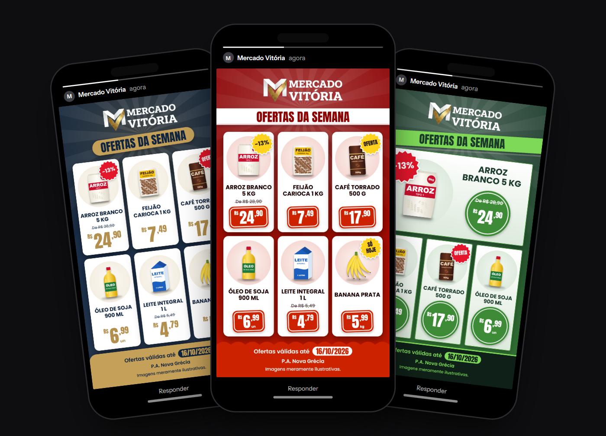
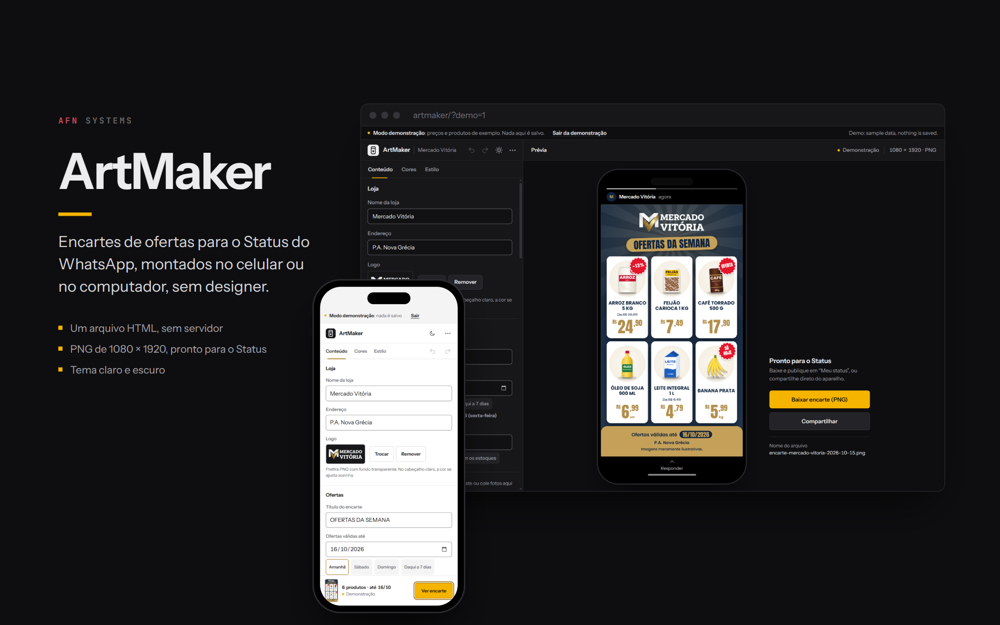
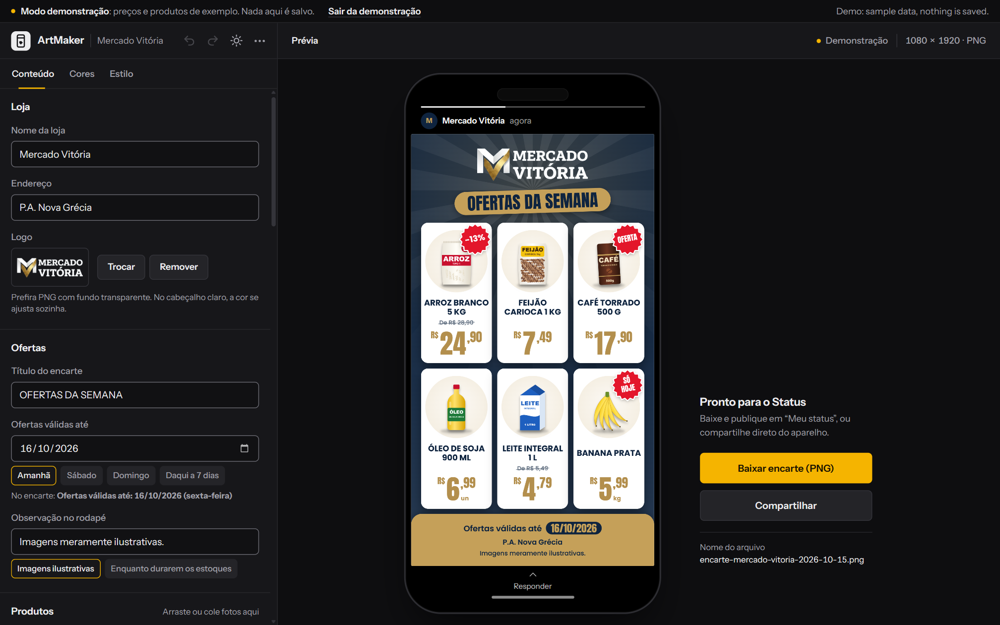
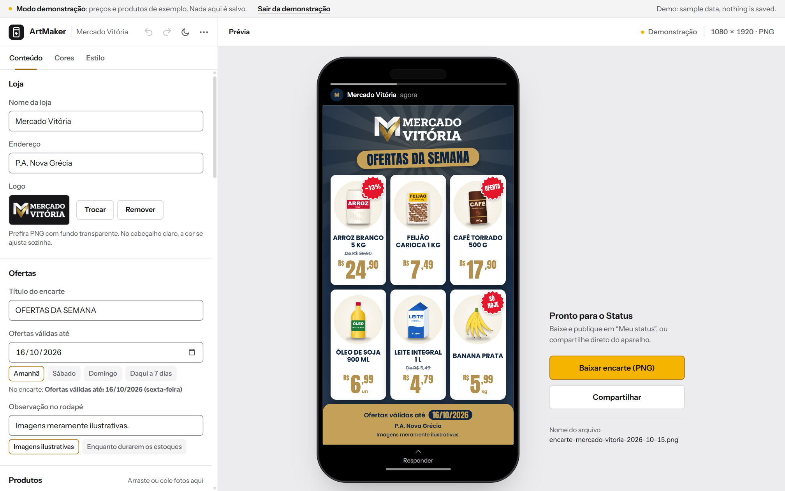
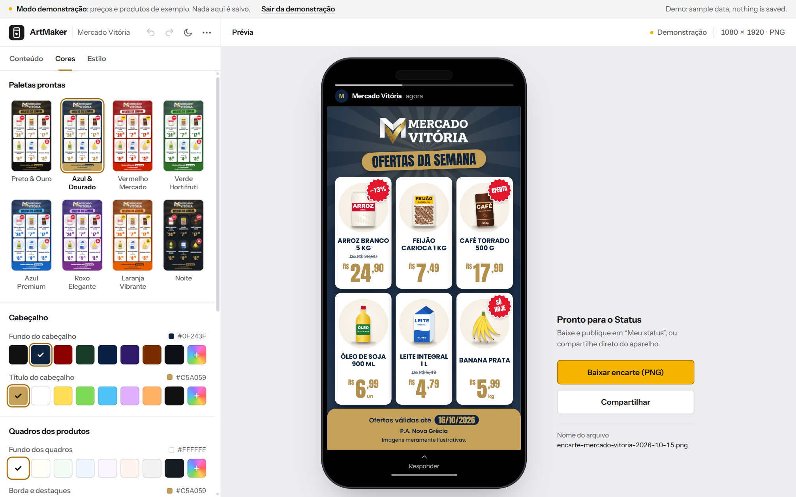
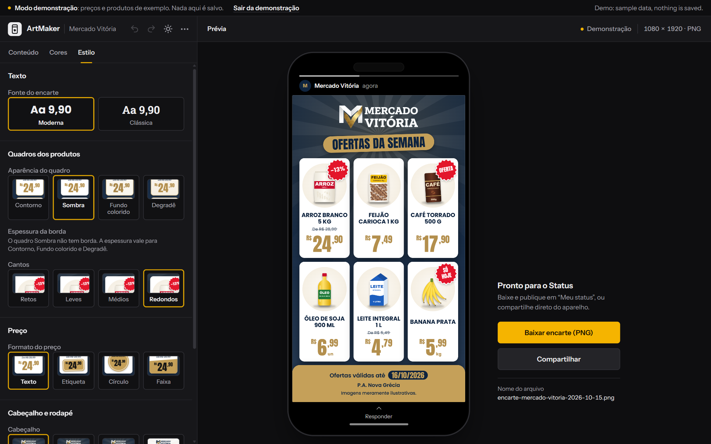
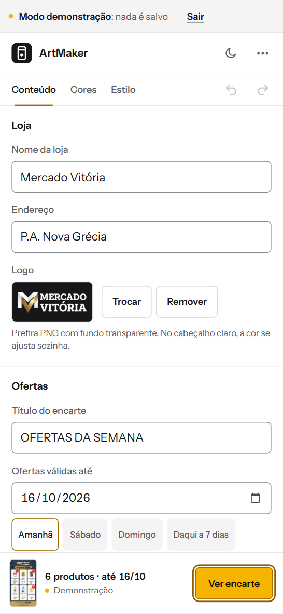

# ArtMaker

Weekly deals flyers for WhatsApp Status, made for a real grocery store in
Brazil.



**[See the live demo](https://alyssom-fernandes.github.io/ArtMaker/?demo=1)**: a
complete flyer with six illustrated products, where nothing is saved. Or
[open an empty editor](https://alyssom-fernandes.github.io/ArtMaker/).

ArtMaker builds promotional flyers in the WhatsApp Status and Stories
format (1080 × 1920). It was made for the owner of Mercado Vitória, a
grocery store in Brazil, so she could publish the week's deals on her
own, from her phone or computer, with no designer and no paid app: she
types the products and prices, picks the photos, and downloads or shares
the finished flyer. Mercado Vitória is a real store; its name and logo
appear with the owner's permission.

It is a single HTML file with plain JavaScript: no framework, no build
step and no server. What the user types and the photos they add stay on
their device; only the fonts are loaded from Google Fonts. The interface
is in Portuguese.

[](https://github.com/alyssom-fernandes/ArtMaker/actions/workflows/testes.yml)


This README is also available in [Portuguese](README.pt-BR.md).

## In 30 seconds

1. Open the [demo](https://alyssom-fernandes.github.io/ArtMaker/?demo=1).
2. In **Cores** (Colors), switch the palette; in **Estilo** (Style), the
   price shape. The flyer changes right away, and the thumbnails are the
   flyer itself.
3. Tap **Baixar** (Download): you get a 1080 × 1920 PNG, ready for Status.

## Screenshots

Taken from the demo mode.



| Editor, dark theme | Editor, light theme |
|---|---|
|  |  |
| **Colors, with the palettes drawn for real** | **Style, with thumbnails drawn by the flyer's own engine** |
|  |  |

| On a phone |
|---|
|  |

## What it does

### Building the flyer

- 1 to 6 products, each with a name, price, unit (kg, un, L…), photo,
  old price ("from R$ … to R$ …") and a badge (OFERTA, SÓ HOJE, or the
  discount percentage, calculated automatically).
- The preview is the flyer itself and updates as you type. While a photo,
  name or price is missing, it says what, and **Ir para o que falta**
  (Go to what's missing) takes you to the field.
- Photos: pick, drag onto a product, paste (Ctrl+V, handy with images
  copied from WhatsApp Web) or select several at once to fill the
  products that have none. Photos are downscaled on load, and transparent
  or white margins are trimmed. Catalog photos with a plain white
  background can have it removed with one tap (**Tirar fundo**).
- Validity by date, with shortcuts (tomorrow, Saturday, Sunday, in 7
  days), and a footer note with suggestions such as "Images are for
  illustration only".
- Reorder products, undo and redo (Ctrl+Z, Ctrl+Shift+Z).

### Branded for the store

- Store name, address and logo. Without a logo, the store name becomes
  the header mark, in the title typeface, on up to two balanced lines. On
  a light header, the white or black part of the logo is recolored
  automatically while the gold stays gold.
- 8 palettes, shown as thumbnails of the flyer itself, and each of the 9
  colors can be changed (8 suggestions plus a free color).
- Style: modern or classic typeface, 4 product box looks, border weight,
  corners, 4 headers, 4 price shapes (text, tag, circle, ribbon) and 4
  footers.

### The flyer itself

- Built to be read in two seconds while scrolling through Status: a
  gradient background in the palette, the title in capitals on a sticker,
  each product on a spot of color and the price in a large condensed
  font. With 3 or 4 products, the first one is featured.
- Prices in grocery-flyer style: small "R$", large reais and raised
  cents.
- Nothing overflows: titles, names and addresses shrink to fit and, at
  the limit, end with an ellipsis; a number and its unit ("500 g") never
  split across lines.
- Names and prices share the same size across each row of product boxes,
  and the photos line up.
- Automatic contrast: if a color combination would make text
  unreadable, the shade is darkened or lightened just enough, without
  changing the chosen color. The Colors tab says when this happens.
- The exported file leaves out the editing hints ("Add photo", "Enter
  the price"); before downloading, the app warns about missing photos,
  names or prices.

### Download, share and print

- Download the PNG with the date in the file name
  (`encarte-mercado-vitoria-2026-10-01.png`).
- Share straight through the system share sheet (WhatsApp, Status,
  Photos) where the browser allows it. The image is prepared before the
  tap, which is what the iPhone requires.
- Print: only the flyer comes out, on an A4 page.
- Save the project to a file (`.artmaker.json`, photos included) and open
  it later on another device.

### It does not lose work

- Saves automatically while you edit: text, colors and style in
  `localStorage`, photos and logo in IndexedDB. Everything is there when
  you come back. If the offer date has passed, it moves to tomorrow, with
  a notice.
- Two open tabs do not overwrite each other: when one saves, the other
  stops saving and says so, so nothing gets lost.
- Unhandled failures are recorded on the device and listed under
  **Sobre** (About), with buttons to copy and clear them. In the console,
  `errosRegistrados()` shows the ones from the current page.

### Phone, themes and accessibility

- On a computer, the preview shows the flyer inside a phone, with the
  WhatsApp Status frame around it, and the buttons beside it with the
  name the file will have. Hovering over a palette shows the flyer in it;
  a click applies it.
- On a phone, the demo opens on the finished flyer. While editing, the
  tabs, with Undo and Redo, stay pinned to the top, and a
  bar at the bottom shows a live thumbnail of the flyer. The preview, the
  About box and the menu open as bottom sheets that close with a swipe
  down. On the keyboard, Enter moves to the next field.
- Light and dark themes that follow the device until the user chooses,
  with no flash on load.
- Everything works from the keyboard: tabs with arrow keys, palettes,
  colors and styles as option groups, visible focus, dialogs that trap
  focus and close with Esc. Honors "reduce motion" and the system's high
  contrast mode.

## How it is built

| Part | Technology |
|---|---|
| Interface | HTML, CSS and JavaScript in a single file, no framework |
| Flyer drawing | Canvas 2D, 1080 × 1920 |
| Data | `localStorage` for state, IndexedDB for photos |
| Sharing | Web Share API with files |
| Fonts | Instrument Sans for the interface; Anton, Poppins and Roboto Slab for the flyer; JetBrains Mono for the signature (Google Fonts) |
| Security | Content Security Policy in a meta tag (each inline script allowed by its SHA-256 hash), no referrer |
| Tests | `node --test`, no dependencies, run on every push (GitHub Actions) |

Some decisions behind it:

- **One file, on purpose.** The store owner can be sent `index.html` and
  it just works. The default logo is embedded (as WebP) because an
  external image opened straight from disk "taints" the canvas and the
  browser blocks the download.
- **The same code draws the preview, the file and the thumbnails.** The
  drawing function takes the canvas context and, for the Style
  thumbnails, a crop of the flyer; export draws on a separate canvas,
  without the editing hints.
- **The calculations that decide what goes on the flyer are tested**:
  reading prices typed the Brazilian way, discounts, contrast, color
  adjustment, local dates, the file name, photo ids and the migration of
  data saved by older versions. The test cuts the block of pure functions
  out of `index.html` itself.
- **The page only runs its own code.** The security policy allows each
  inline script by its hash and, from outside, only Google Fonts. A test
  recomputes the hashes, so changing a script without updating the policy
  fails the build instead of breaking the live page.

## Known limitations

- Fonts come from Google Fonts, so the browser contacts Google to fetch
  them (nothing typed or uploaded goes along). Without internet on the
  first visit, the flyer uses system fonts.
- GitHub Pages does not allow custom headers, so the security policy is
  set in a meta tag. That form cannot stop another site from embedding
  the page in a frame.
- **Compartilhar** (Share) needs HTTPS and a browser that can share files
  (Chrome on Android, Safari on iPhone). On a computer, usually only
  **Baixar** (Download) shows up.
- HEIC photos (the iPhone camera's default) only open in browsers that
  read that format, such as Safari. Elsewhere, the app asks for a JPG.
- Data stays in the device's browser. Clearing the site's data erases the
  flyer; to keep it or move it to another device, use **Salvar projeto em
  arquivo** (Save project to a file), in the menu.
- The interface is in Portuguese only. In the demo, the banner at the top
  also says in English, on wide screens, that the data is a sample.

## Running your own copy

1. Download `index.html` and open it in a browser. That is all.
2. Change the store name, address and logo in the **Conteúdo** tab. The
   new logo is kept on the device.
3. To get the **Compartilhar** (Share) button on a phone, the file has to
   be served over HTTPS (GitHub Pages works); opened straight from disk,
   the browser does not allow sharing files, and **Baixar** (Download)
   keeps working.

To run the tests (Node 18 or newer, nothing to install):

```bash
node --test
```

## Project structure

```
index.html            the whole app: interface, flyer drawing and the default logo
404.html              not-found page
tests/
  puro.test.mjs       tests for the pure functions in index.html
  csp.test.mjs        checks that the security policy allows exactly the page's scripts
.github/workflows/
  testes.yml          runs the tests on every push
docs/telas/           images used in this README and the link preview (og.png)
```

## License

[MIT](LICENSE). Made by [Alyssom Fernandes](https://github.com/alyssom-fernandes), AFN Systems.
